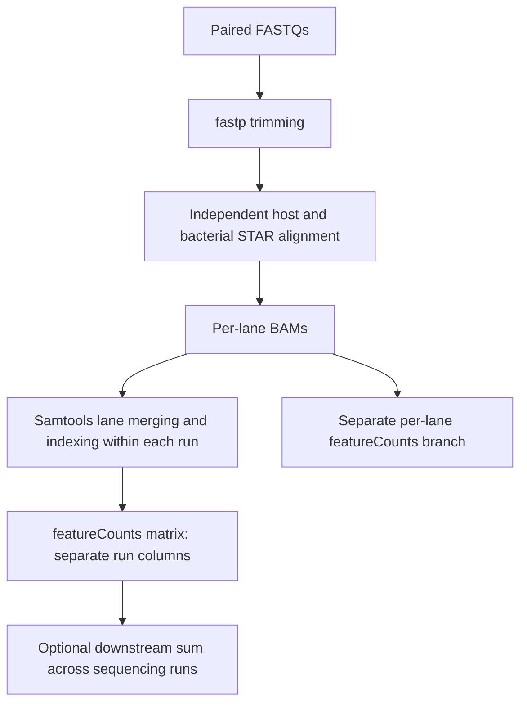

# FASTQ to featureCounts

This guide maps the recovered pipeline source. Exact current copies are in [hpc/2026-10-29](hpc/2026-10-29/); earlier curated copies remain in the numbered stage directories.

| Stage | Recovered source |
| --- | --- |
| Raw FastQC/MultiQC | [QC.sh](hpc/2026-10-29/QC.sh) |
| fastp trimming | [trim_fastp.sh](hpc/2026-10-29/Analysis/trim_results/trim_fastp.sh) |
| Reference configuration | [pipeline_config.sh](hpc/2026-10-29/Analysis/Alignment/pipeline_config.sh) |
| STAR alignment | [dual_rnaseq_workflow.sh](hpc/2026-10-29/Analysis/Alignment/dual_rnaseq_workflow.sh) |
| Alignment/counting Slurm jobs | [Slurm_scripts](hpc/2026-10-29/Analysis/Alignment/Slurm_scripts/) |
| Host lane merging/indexing | [Host shell and Slurm](hpc/2026-10-29/Analysis/Anton_downstream_mapping/Bam_indexing/Host/) |
| Bacterial lane merging/indexing | [Bacteria shell and Slurm](hpc/2026-10-29/Analysis/Anton_downstream_mapping/Bam_indexing/Bacteria/) |
| Newer merged-host counting | [featurecounts_host.sh](hpc/2026-10-29/Analysis/Anton_downstream_mapping/FeatureCounts/FeatureCounts_host/featurecounts_host.sh) |
| Historical host Slurm variant | [run_featurecounts_host.sbatch](hpc/2026-10-29/Analysis/Anton_downstream_mapping/FeatureCounts/run_featurecounts_host.sbatch) |
| Earlier successful merged-bacterial method | [numbered-stage run_featurecounts_bacteria.sh](04_feature_counting/run_featurecounts_bacteria.sh) |
| Current merged-bacterial source and Slurm wrapper, including failed edit | [FeatureCounts_bacteria](hpc/2026-10-29/Analysis/Anton_downstream_mapping/FeatureCounts/FeatureCounts_bacteria/) |
| Alignment/QC orchestration | [post_alignment_analysis.sh](hpc/2026-10-29/Analysis/Alignment/post_alignment_analysis.sh), [Aligment_QC](hpc/2026-10-29/Analysis/Alignment/Aligment_QC) |
| Merged BAM QC | [Bam_indexing helpers](hpc/2026-10-29/Analysis/Anton_downstream_mapping/Bam_indexing/) |

## Method and version distinctions

- The recovered STAR implementation aligns the same trimmed pair independently to host and bacterial references. Representative historical BAM program records corroborate this. It does not establish a bacterial pass using only host-unmapped reads or a SortMeRNA-filtered input branch.
- Lane merging combines lanes within a sample and sequencing run. Summing Run 1 and Run 2 count columns is a separate downstream aggregation step.
- The newer merged-host shell script uses `--fracOverlap 0.5 --fracOverlapFeature 0.5 -Q 10`. The recovered older host Slurm variant and earlier numbered-stage host script have different settings; they are not interchangeable descriptions of the same matrix version.
- The surviving merged-bacterial matrix was produced with `-t gene -g ID`. The later recovered bacterial edit changes the identifier to `gene_id` and adds an overlap filter. Its rerun failed because that annotation lacks the requested attribute. The exact failed edit is preserved in the dated snapshot; the earlier successful command remains in the numbered-stage script.
- Observed native output headers record featureCounts 2.1.1. Configuration pins alone are not executed-version evidence. Existing commands omit `--countReadPairs`; preserve their recorded read-count semantics when identifying results. The [Subread documentation](https://subread.sourceforge.net/featureCounts.html) describes the explicit fragment-counting option.

## Scope of verification

All recovered source bytes and their syntax were checked. Execution logs, BAM program headers, and native matrix headers were inspected locally without rerunning processing. Source-at-submission digests are unavailable for historical jobs; current copies cannot certify every historical submitted byte. Some ancillary helpers are included as recovered code, rather than established required stages.

Original raw FASTQs were absent from the checked location. Remaining trimmed paths and BAM inputs were inspected, and a stale saved sample manifest was identified. Detailed sample/path records, matrix identities, and export-integrity findings remain in the local audit. These source copies retain their original absolute deployment paths and dependencies; no automatic deployment or scientific rerun is part of this update.
